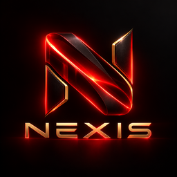

# Official NEXIS branding



ASH approved `assets/branding/NEXIS LOGO.png` on 2026-10-25. Keep this original
1254 × 1254 PNG unchanged. Its SHA-256 is
`cee617446391da8bf0f3d348f96e0f629e11aa8c9dc9e30356c577d721794b4c`.
The runtime `NEXIS_logo.png` is a byte-for-byte copy. Preserve the metallic N,
blood-red glow, gold edges, black background and NEXIS wordmark in every theme.
Do not recolor the approved artwork to match a selected UI theme.

## Generated assets

`scripts/prepare_branding.py` verifies the approved source hash before writing.
It crops only the N symbol at source pixel bounds `(265,155)-(995,855)` for small
icons, pads to a square on black, and uses Lanczos scaling. It never redraws the
logo, removes its background, or stretches its aspect ratio.

- `NEXIS.ico`: N-only frames at 16, 20, 24, 32, 40, 48, 64, 96, 128 and 256 px.
- `NEXIS_symbol.png`: 512 px N-only runtime badge and installer header.
- `scaled/NEXIS-symbol-{size}.png`: those ten sizes plus 512 px.
- `scaled/NEXIS-logo-{size}.png`: full artwork at 128, 256, 512 and 1024 px.
- `installer-sidebar.png`: full artwork centered on a 492 × 942 black canvas.
- `manifest.json`: source hash, crop bounds, roles, dimensions and asset hashes.

The installer sidebar maintains Inno Setup's 164:314 display area; the large
source avoids unnecessary upscaling. The header uses the N-only asset. See
[Inno's sidebar documentation](https://jrsoftware.org/ishelp/topic_setup_wizardimagefile.htm)
and [header image documentation](https://jrsoftware.org/ishelp/topic_setup_wizardsmallimagefile.htm).
Generated release artwork stays in the repository. Only three runtime assets
(full PNG, symbol PNG and ICO) are copied to `src/nexis/assets/branding` and
bundled; Pillow is a development dependency, never an application dependency.

## Application and Windows identity

The full artwork appears in splash, About and onboarding. The main header and
floating companion use the N badge alongside existing text. The companion's
reactor, state indicators, controls and selected theme remain functional.
`BrandLogo` renders at the current device pixel ratio and refreshes on a display
scale change. Logo rendering introduces no timer or animation.

`nexis.branding.asset()` resolves only known packaged resources relative to its
module, independent of the working directory. Executable, window, taskbar,
tray, installer and uninstaller use the same N-symbol ICO. Setuptools and
PyInstaller include identical runtime assets. Copy the entire portable folder,
including `_internal`, when distributing a development candidate.

Keep the Windows AppUserModelID `NEXIS.Desktop` stable. Inno's Start Menu and
optional desktop shortcuts refer to the installed executable's embedded icon
and use that AppUserModelID. Existing pinned Windows shortcuts can retain an
Explorer-cached icon until Windows refreshes them; do not delete icon caches,
restart Explorer, or alter the owner's pins as part of branding QA.

## Rebuild and verification

With the project's development dependencies installed:

```text
python scripts/prepare_branding.py
python -m pytest tests/ui/test_branding.py tests/ui/test_approved_branding.py
python scripts/verify_five_rounds.py --output <new-verification-directory>
python scripts/build_development_candidate.py --verification <new-verification-directory>/results.json --output dist/<new-development-directory> --iscc <ISCC.exe>
python scripts/check_package.py --folder dist/<new-development-directory>/payload/NEXIS --output <new-package-evidence-directory>
python scripts/check_windows_branding.py --output <new-shell-evidence-directory> <new-NEXIS.exe> <new-Setup.exe>
```

For the managed workspace runtime, add `.dev-deps` for asset generation and use
`scripts/dev.py test` for pytest. The build helper supports `--workspace-runtime`.
It requires passing regression evidence for the exact current source fingerprint,
which covers every source and packaged branding asset. Never overwrite an
existing distribution or use historical results to qualify new source.

Build 1.3.7 is a new development revision. The previously verified 1.3.4, 1.3.5 and
1.3.6 distributions and owner settings/credentials must remain untouched. This
branding change does not qualify microphones, speakers, providers, licensing,
clean Windows installations, or public release. ASH alone approves publication.
